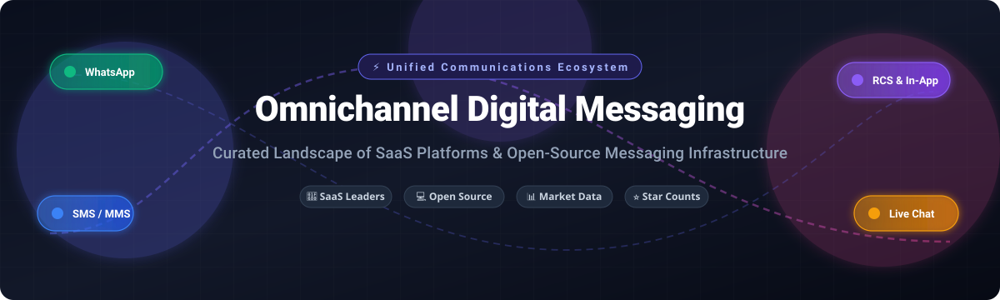

<p align="center">
  
</p>

# 💬 Awesome Omnichannel Digital Messaging

<p align="center">
  <a href="https://github.com/ishandutta2007/Awesome-Awesome-Awesome"></a>
  <a href="https://discord.gg/jc4xtF58Ve"></a>
  <a href="https://github.com/ishandutta2007/Awesome-Omnichannel-Digital-Messaging/stargazers"></a>
  <a href="https://github.com/ishandutta2007/Awesome-Omnichannel-Digital-Messaging/network/members"></a>
  <a href="https://github.com/ishandutta2007/Awesome-Omnichannel-Digital-Messaging/issues"></a>
  <a href="https://github.com/ishandutta2007/Awesome-Omnichannel-Digital-Messaging/blob/main/LICENSE"></a>
  <a href="https://github.com/ishandutta2007"></a>
</p>

> 🌟 **The definitive, curated landscape of Omnichannel Digital Messaging Tools, CPaaS platforms, Conversational AI systems, and self-hosted Open-Source communication stacks.**  
> *Track multi-channel customer engagement solutions across SMS, WhatsApp, RCS, Facebook Messenger, Instagram, Telegram, Email, and Web Chat.*

---

## 📌 Table of Contents
- [🔍 Sector Overview & Market Dynamics](#-sector-overview--market-dynamics)
- [🏢 Enterprise SaaS & CPaaS Platforms](#-enterprise-saas--cpaas-platforms)
- [💻 Open-Source GitHub Projects](#-open-source-github-projects)
- [🛠️ Architectural Blueprints](#-architectural-blueprints)
- [🤝 How to Contribute](#-how-to-contribute)
- [💖 Support & Sponsorship](#-support--sponsorship)
- [📈 Star History](#-star-history)
- [⚠️ Disclaimer](#-disclaimer)

---

## 🔍 Sector Overview & Market Dynamics

The global omnichannel digital messaging and customer communication software market was valued at approximately **$7.8 billion in 2025** and is projected to surge past **$39 billion by 2035** at a **17.5% CAGR**, fueled by enterprise migration away from siloed legacy inboxes toward unified, AI-orchestrated customer communication hubs.

Rather than developing into a pure winner-take-all monopoly, the industry displays **moderate fragmentation with an oligopolistic core**:
- **Enterprise Core:** Global hyper-scalers (Salesforce, Twilio, Ericsson/Vonage, Sinch, Infobip) dominate international carrier routing, CRM consolidation, and enterprise compliance.
- **Regional & Channel Realities:** Conversational dominance is regionalized (e.g., WhatsApp across Latin America and India, LINE in Japan/Taiwan, KakaoTalk in South Korea), requiring specialized localized gateways.
- **Data Sovereignty & Self-Hosting:** Stringent privacy laws (GDPR, HIPAA) have accelerated the rise of extensible open-source platforms (Chatwoot, Novu, Element/Matrix), creating a vibrant, multi-layered competitive ecosystem.

---

## 🏢 Enterprise SaaS & CPaaS Platforms

| Platform | Valuation / Market Cap / Revenue 📊 | Starting Tier Pricing 💰 | Free Tier & Trial Limits ⏳ | Key Capabilities & Channels 🌐 |
| :--- | :--- | :--- | :--- | :--- |
| **[Salesforce Digital Channels](https://www.salesforce.com/service/digital-channels/)** | ~$38B+ Annual Revenue (~$270B Market Cap) | $75/user/month (Digital Engagement add-on to Service Cloud) | 30-day free trial of Service Cloud (sandbox environment; custom demo for digital channels) | Omnichannel messaging suite integrating SMS, WhatsApp, Facebook Messenger, and web chat directly into Service Cloud CRM. |
| **[Vonage Messages API](https://www.vonage.com/communications-apis/messages/)** | $6.2B (Acquired by Ericsson; ~$2.0B business revenue) | $0.00121/delivered message (SMS starts at ~$0.008/msg; carrier pass-through fees apply) | €2 free credit upon sign-up, no credit card required; access to Messages API Sandbox (capped to 10 verified test numbers in demo mode) | Single multi-channel messaging API endpoint connecting SMS, MMS, WhatsApp Business, Messenger, and Viber. |
| **[Twilio Conversations](https://www.twilio.com/conversations)** | ~$4.5B Annual Revenue (~$18B Market Cap) | $0.05/active user/month (plus underlying carrier/message fees) | First 200 Monthly Active Users (MAUs) free every month forever; includes 200 MAU participant capacity | Cross-channel conversation orchestration API coordinating SMS, MMS, WhatsApp, chat widgets, and custom webhooks. |
| **[Sinch](https://www.sinch.com/)** | ~$2.7B Annual Revenue (~$1.8B Market Cap) | $0.0078/message (SMS US baseline; WhatsApp conversation fees apply) | $2 USD test credit on developer account; 14-day free trial on Sinch Engage/Converse platform with no credit card required | Global cloud communication platform for SMS, WhatsApp, RCS, voice, and video with unified conversation APIs. |
| **[Infobip](https://www.infobip.com/)** | ~$1.8B+ Annual Revenue (~$10B Valuation) | $0.008/SMS (pay-as-you-go; AgentOS starts at ~$530/month) | 60-day free trial with no credit card required; trial capped at 100 messages per channel (SMS, WhatsApp, Email) and 15 calls | Global CPaaS offering enterprise SMS, WhatsApp Business, RCS, Email, and AI agent customer engagement orchestration. |
| **[Bird (MessageBird)](https://bird.com/)** | ~$600M+ Annual Revenue (~$3.8B Valuation) | Pay-as-you-go from $0.005/msg (SMS from $0.0075/msg, WhatsApp from $0.005/msg) | Free sign-up forever with access to APIs, Flow Builder, and test credit sandbox for verified numbers | Omnichannel communication platform with visual Flow Builder, CRM data sync, SMS, WhatsApp, email, and voice. |
| **[Sprinklr](https://www.sprinklr.com/)** | ~$730M Annual Revenue (~$2.0B Market Cap) | Custom enterprise quote (typical entry contracts start at ~$50,000–$100,000/year) | No free tier or self-serve free trial; guided demo available via sales consultation | Enterprise unified customer experience management platform with social messaging, conversational AI, and contact centers. |
| **[LivePerson](https://www.liveperson.com/)** | ~$320M Annual Revenue (~$150M Market Cap) | Custom enterprise quote (starter tiers historically quoted from ~$599/month for up to 2,000 conversations) | No free tier or public self-serve trial; personalized sandbox/guided demo available on request | Enterprise conversational AI and customer engagement platform across web, mobile apps, WhatsApp, and social channels. |
| **[Gupshup](https://www.gupshup.io/)** | ~$250M+ Annual Revenue (~$1.4B Valuation) | $0.001/message platform fee (plus Meta WhatsApp conversation rates; no monthly fee on self-serve) | Free account creation with self-serve pay-as-you-go sandbox; free guided enterprise demo upon request | Conversational messaging platform specializing in WhatsApp Business API, RCS, SMS, and bot automation workflows. |

---

## 💻 Open-Source GitHub Projects

Curated open-source projects for self-hosting, full data ownership, privacy compliance, and developer extensibility, sorted by GitHub popularity:

- **[Rocket.Chat](https://github.com/RocketChat/Rocket.Chat)** [](https://github.com/RocketChat/Rocket.Chat/stargazers)  
  🚀 Open-source team communication and customer messaging platform with omnichannel live chat, WhatsApp, and SMS integrations.
- **[LibreChat](https://github.com/danny-avila/LibreChat)** [](https://github.com/danny-avila/LibreChat/stargazers)  
  🤖 Open-source AI chat platform with multi-channel messaging support and extensible plugin architecture for unified conversational interfaces.
- **[Novu](https://github.com/novuhq/novu)** [](https://github.com/novuhq/novu/stargazers)  
  🔔 Open-source notification infrastructure with unified API for in-app, email, SMS, push, and chat messages with digest orchestration.
- **[Mattermost](https://github.com/mattermost/mattermost)** [](https://github.com/mattermost/mattermost/stargazers)  
  💬 Open-source collaboration and secure messaging platform with extensible webhooks and bot integrations for customer conversations.
- **[Chatwoot](https://github.com/chatwoot/chatwoot)** [](https://github.com/chatwoot/chatwoot/stargazers)  
  🎯 Open-source omnichannel customer engagement platform supporting live chat, email, WhatsApp, Facebook, Instagram, SMS, and Telegram. Self-hosted alternative to Intercom and Zendesk. MIT licensed.
- **[Jitsi Meet](https://github.com/jitsi/jitsi-meet)** [](https://github.com/jitsi/jitsi-meet/stargazers)  
  📹 Open-source video conferencing with integrated real-time text chat and SIP gateway for unified communication systems.
- **[Zulip](https://github.com/zulip/zulip)** [](https://github.com/zulip/zulip/stargazers)  
  ⚡ Open-source team chat and messaging tool featuring organized topic-based threading, mobile clients, and webhooks for customer ticket integration.
- **[Krayin CRM](https://github.com/krayin/laravel-crm)** [](https://github.com/krayin/laravel-crm/stargazers)  
  💼 Open-source CRM with omnichannel communication features including email, SMS, and chat integration for sales engagement.
- **[LiveKit](https://github.com/livekit/livekit)** [](https://github.com/livekit/livekit/stargazers)  
  🎙️ End-to-end open-source WebRTC stack for real-time audio, video, and multi-modal conversational messaging infrastructure.
- **[Botpress](https://github.com/botpress/botpress)** [](https://github.com/botpress/botpress/stargazers)  
  🧠 Open-source conversational AI platform enabling multi-channel bot deployments across WhatsApp, Telegram, Slack, Web Chat, and Messenger.
- **[Element Web](https://github.com/vector-im/element-web)** [](https://github.com/vector-im/element-web/stargazers)  
  🛡️ Feature-rich Matrix collaboration web client supporting federated end-to-end encrypted messaging and bridging networks.
- **[Tinode](https://github.com/tinode/chat)** [](https://github.com/tinode/chat/stargazers)  
  📱 Open-source instant messaging platform with chat bots, video calls, and multi-device synchronization for custom digital apps.
- **[Signal Server](https://github.com/signalapp/Signal-Server)** [](https://github.com/signalapp/Signal-Server/stargazers)  
  🔒 Open-source server backend supporting secure, end-to-end encrypted private messaging across mobile and desktop clients.
- **[Typebot](https://github.com/baptisteArno/typebot.io)** [](https://github.com/baptisteArno/typebot.io/stargazers)  
  ✨ Open-source conversational app builder allowing embedded web and WhatsApp form automation for omnichannel interactions.
- **[Fonoster](https://github.com/fonoster/fonoster)** [](https://github.com/fonoster/fonoster/stargazers)  
  📞 Open-source alternative to Twilio for programmable voice, messaging, and conversational IVR pipelines.
- **[Matterbridge](https://github.com/42wim/matterbridge)** [](https://github.com/42wim/matterbridge/stargazers)  
  🌉 Universal bridge between multiple chat protocols (Slack, Discord, Telegram, IRC, Matrix, and more) for multi-network sync.
- **[Ejabberd](https://github.com/processone/ejabberd)** [](https://github.com/processone/ejabberd/stargazers)  
  🌐 Robust XMPP server for scalable messaging with mobile push, multi-protocol support, and high concurrency.
- **[Papercups](https://github.com/papercups-io/papercups)** [](https://github.com/papercups-io/papercups/stargazers)  
  💬 Open-source live customer chat platform with Slack, email, and SMS integrations. Self-hostable alternative to Intercom.
- **[Zammad](https://github.com/zammad/zammad)** [](https://github.com/zammad/zammad/stargazers)  
  🎫 Open-source helpdesk and customer support system with omnichannel messaging via email, chat, Telegram, Facebook, and SMS.
- **[Matrix Synapse](https://github.com/element-hq/synapse)** [](https://github.com/element-hq/synapse/stargazers)  
  🏛️ Reference homeserver for the Matrix decentralized communication protocol, enabling federated chat across bridges.
- **[Jitsi Core](https://github.com/jitsi/jitsi)** [](https://github.com/jitsi/jitsi/stargazers)  
  📡 Open-source audio/video and SIP communicator engine for unified communication systems.
- **[Mautrix WhatsApp](https://github.com/mautrix/whatsapp)** [](https://github.com/mautrix/whatsapp/stargazers)  
  🔄 Matrix-to-WhatsApp bridge allowing bi-directional messaging between decentralized Matrix rooms and WhatsApp chats.

### 🌐 Additional Notable Bridges & Ecosystem Protocols

- **[Matrix Protocol](https://github.com/matrix-org)** — Open standard for decentralized, real-time communication with bridges to WhatsApp, Telegram, Slack, and SMS.
- **[Mautrix Bridges](https://github.com/mautrix)** — Community bridge collection connecting WhatsApp, Telegram, Signal, iMessage, and Discord to open protocols.
- **[Openfire](https://github.com/igniterealtime/Openfire)** — XMPP-based real-time collaboration server with multi-channel messaging plugins.
- **[Tawk.to SDK](https://github.com/tawk/tawk-messenger-js)** — Open-source JavaScript SDK for embedding multi-device chat widgets.
- **[Signal K](https://github.com/SignalK)** — Open-source data interchange platform for IoT sensor and device-to-human alerting.

---

## 🛠️ Architectural Blueprints

Build a modern, scalable, data-sovereign digital messaging architecture using open-source tools:

```
[ Customer Touchpoints ]
SMS / WhatsApp / RCS / Email / Web Chat / Telegram
                 │
                 ▼
[ Ingestion & Bridging Layer ]
Mautrix Bridges / Matterbridge / Fonoster Webhooks
                 │
                 ▼
[ Unified Inbox & Agent Workspace ]
Chatwoot (Omnichannel Inbox)  ◄──►  Novu (Notification Orchestration)
                 │
                 ▼
[ Message Bus & Event Streaming ]
RabbitMQ / Apache Kafka / Redis Streams
                 │
                 ▼
[ Storage & Analytics ]
PostgreSQL / ClickHouse / Elasticsearch
```

---

## 🤝 How to Contribute

Contributions are warmly welcomed! Help make this curated catalog the most comprehensive reference in omnichannel messaging:

1. 🍴 Fork the repository.
2. 🌿 Create your feature branch (`git checkout -b feature/add-new-messaging-tool`).
3. 📝 Add your entry ensuring factual data, transparent pricing/free tier parameters, and relevant documentation links.
4. 🚀 Commit your changes (`git commit -m "Add new omnichannel messaging platform"`).
5. 📤 Push to the branch (`git push origin feature/add-new-messaging-tool`).
6. 📬 Open a Pull Request with a short summary of the addition.

---

## 💖 Support & Sponsorship

Thank you so much for exploring and supporting **Awesome Omnichannel Digital Messaging**! 🌟

If you find this repository valuable for your projects, architecture planning, or research:
- ⭐ **Star this repository** to help others discover it!
- 🍴 **Fork it** to customize it for your internal team or stack!
- 📢 **Share it** on Twitter, LinkedIn, Reddit, or developer forums!
- ☕ **Buy me a coffee & support ongoing maintenance:** Visit the [GitHub Sponsors Dashboard](https://github.com/sponsors/ishandutta2007) to sponsor the project!

Every bit of support and community contribution keeps this catalog up to date and comprehensive! 🚀

---

## 📈 Star History

[](https://star-history.dera.page/#ishandutta2007/Awesome-Omnichannel-Digital-Messaging&type=date&legend=top-left)

---

## ⚠️ Disclaimer

- This is a **community-curated list** — entries are listed objectively for informational and technical comparison purposes and do not represent formal commercial endorsements.
- Telecom-based messaging channels (SMS, MMS, RCS, WhatsApp Business) are subject to carrier fees, regulatory compliance (e.g., A2P 10DLC, GDPR, TCPA), and Meta/carrier policy guidelines.
- Self-hosted open-source software deployments require appropriate security audits, rate-limiting, and infrastructure hardening for enterprise workloads.

---

<p align="center">
  <b>Built with ❤️ for developers, contact center architects, and engineers crafting unified digital conversation systems.</b>
</p>
